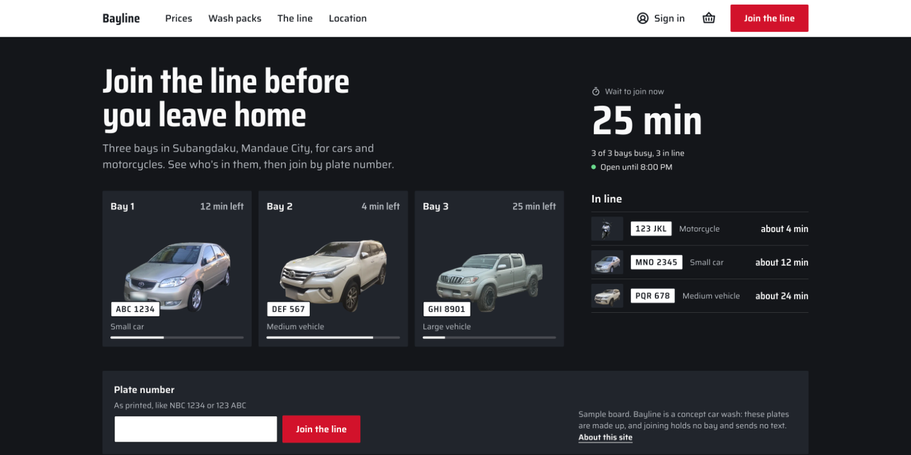
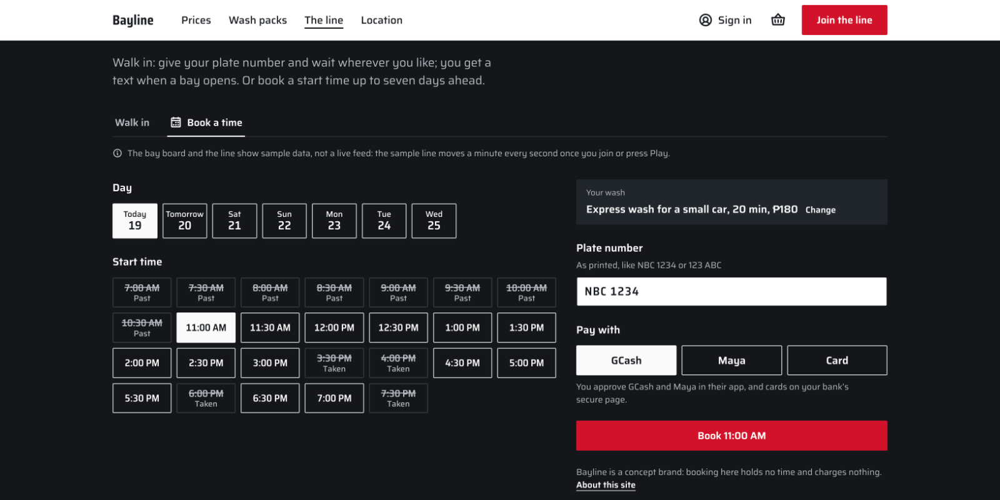
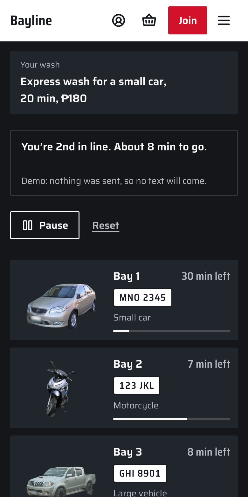
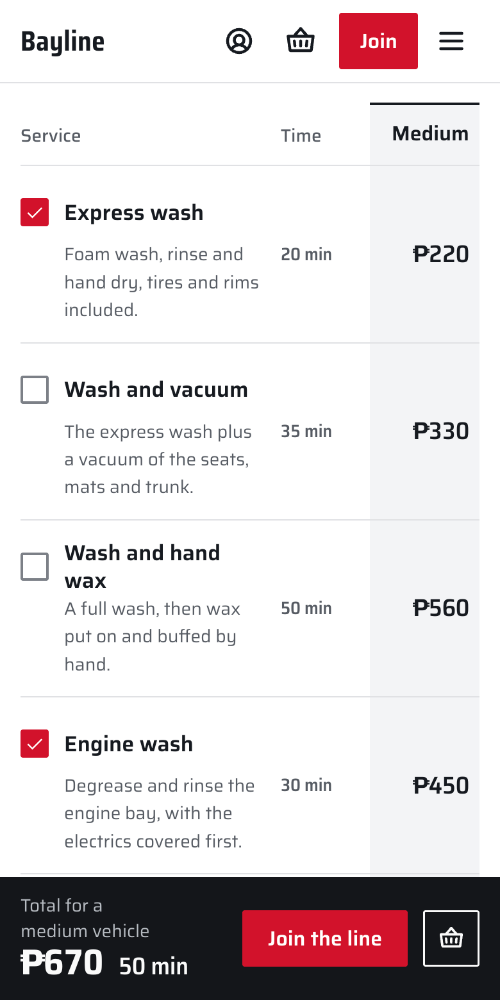

# Bayline

Bayline is a concept car wash and detailing shop in Subangdaku, Mandaue City: three bays, cars and motorcycles, open
7:00 AM to 8:00 PM every day. This is its website. It shows the wait before you drive over, lets you join the
line by plate number or book a time, and prices every wash by vehicle.

  
  

## Pages

- **Home**: the bay board first (who is in each of the three bays, the cars in line, the wait right now and whether
  Bayline is open), with a plate field that takes you straight into the line; then the full price table with a photo
  of each vehicle size over its column, the capped wash packs in one strip (twice a week, for less), and where Bayline
  is with today's hours.
- **Prices** (`/services/`): every service by vehicle, with a running total, the time it takes and "Add to basket".
- **Wash packs** (`/plans/`): Express 4, Express 8 and Care 4 for your vehicle, what each saves against paying per wash,
  the fair-use rules, and "Add to basket".
- **The line** (`/visit/`): walk in by plate number and watch the bays, or book a time and choose GCash, Maya or card. On phones the join form comes before the board.
- **Location** (`/location/`): the area, the hours ("Every day, 7:00 AM to 8:00 PM" with whether it is open now or when it opens next, in Mandaue time) and the FAQ.
- **Account** (`/account/`): sign in, in two steps, with a first name, an email or mobile number and a one-time code; your wash pack, the washes left this month and your bookings (a small board beside the sign-in shows what an account holds).
- **Basket** (`/basket/`): the wash to book and the wash pack to start, with plates and payment.
- **About, Contact, Terms of Service, Privacy Policy, Cookie Policy, Accessibility**: the company and legal pages, linked
  from the footer.

## What you can do

- See the bays, the line and the wait for a walk-in right now on the home page, in Mandaue time wherever you are.
  Outside opening hours the wait sign says when Bayline opens instead. Type your plate there and "Join the line" takes
  it to the line page, which joins you (or says what's wrong with the plate).
- Pick your vehicle (small, medium, large or motorcycle) and tick services. The total and the time add up as you go, and
  anything your vehicle can't get is switched off with the reason.
- Take your choice to the line: "Join the line with these" carries the vehicle and services to the walk-in page.
- Walk in: type your plate the way it's printed (lowercase and hyphens are fine), join the line and watch the board. Each
  bay shows a photo of the class of vehicle in it, its plate and the minutes left; your place counts down, and a notice
  says which bay is ready for your plate.
- Book a time: choose one of the next seven days and a start time that fits your services before closing, then GCash,
  Maya or card. Ceramic coating is a full-day job, so it only offers the 8:00 AM drop-off.
- Fill a basket: services from the price list and a wash pack from the packs page. Remove what you don't want, set how
  many packs (one plate each), then choose a time for the wash or start the pack with its plate numbers and a payment
  choice. Packs are capped (4 or 8 express washes, or Care 4), one wash a day, no carry-over, and cost 80 to 92% of
  paying per wash.
- Sign in with your first name and an email address or mobile number; the one-time code appears on screen. Your account
  lists your wash pack with the washes left this month and the times you booked, and lets you cancel the pack, cancel a
  booking or sign out.
- Send a message from the contact page.
- On a phone, open the menu: a full-screen panel with whether Bayline is open now, the pages, and "Join the line".
- Check the footer on any page for whether Bayline is open, the hours and how many cars are in line.

## How it's built

Vite (thirteen pages sharing one header and footer, and two sharing the bay board's tiles and line, all included at build time), TypeScript and Tailwind CSS v4, with no
framework or UI library. The pricing, plate, queue, schedule, wash pack, basket and account logic is pure TypeScript in
`app/lib/`, covered by Node's built-in test runner; the interface (the page folders in `app/`, `app/shared/` and `app/components/`) only wires it to the page, and browser-level tests (beside the pages they drive, jsdom) load the real pages and drive them with clicks, typing and keys. The
design system, "Wet Bay", uses real car-wash photography, white sections, a
graphite band for the bay board and a graphite signboard footer, one red for actions, and Saira with its width axis. Every colour is an oklch theme
variable (a test fails on any hex colour), and icons come from Phosphor, inlined into the HTML at build time.

## A concept, not a business

Bayline is a concept brand, and this is a demonstration site. The wait and the line are a simulation with made-up sample
plates, and the prices are samples. Nothing you enter is sent anywhere: joining the line or booking sends no text, the
sign-in code is shown on screen instead of texted, the basket opens no payment page and charges nothing, and the contact
form sends nothing. A plate typed on the home page reaches the line page through this tab's session storage, never the
address. Your sign-in, basket, wash pack and bookings live only in your browser's local storage
(the Cookie Policy page lists the keys). Every page carries a `noindex` tag so it never turns up in local searches. The
photographs are free-licence pictures of other places and cars, credited on the page and in
[REFERENCES.md](REFERENCES.md).

## License

The code is released under the [MIT License](LICENSE). Saira is used under the SIL Open Font License and Phosphor Icons
under the MIT License; photo licences and credits are in [REFERENCES.md](REFERENCES.md).

Running it locally or contributing? See [DEVELOPMENT.md](DEVELOPMENT.md).
